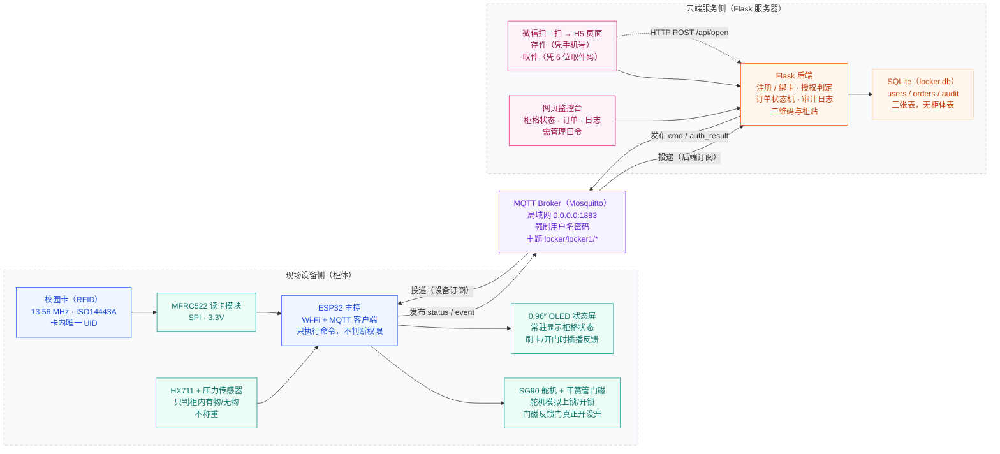
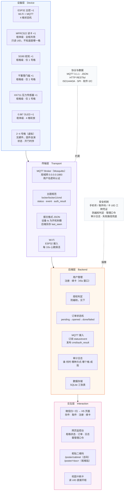
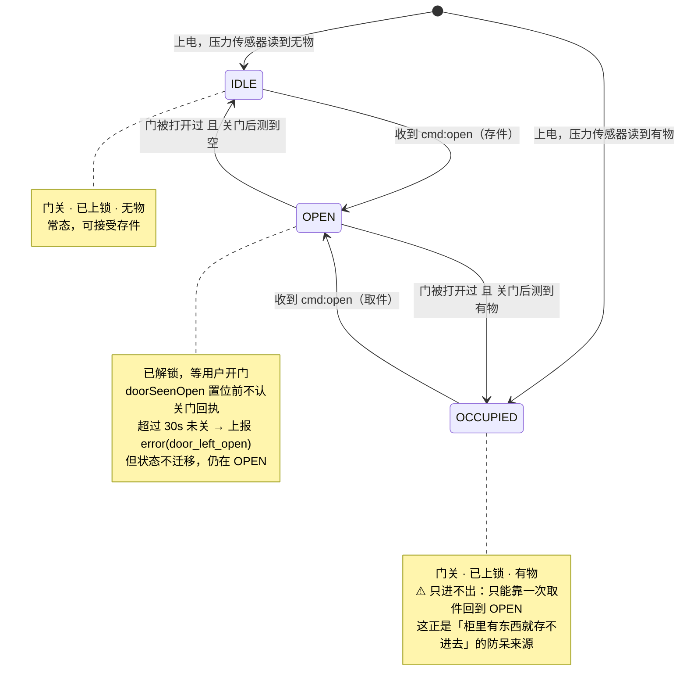
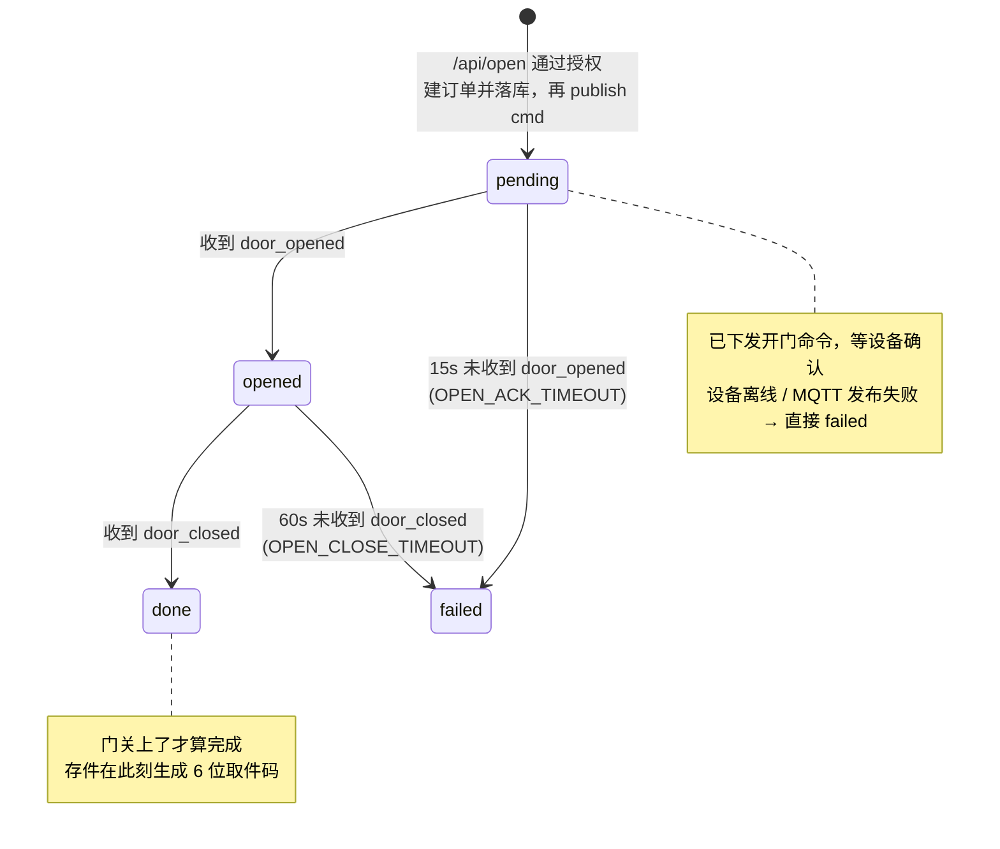
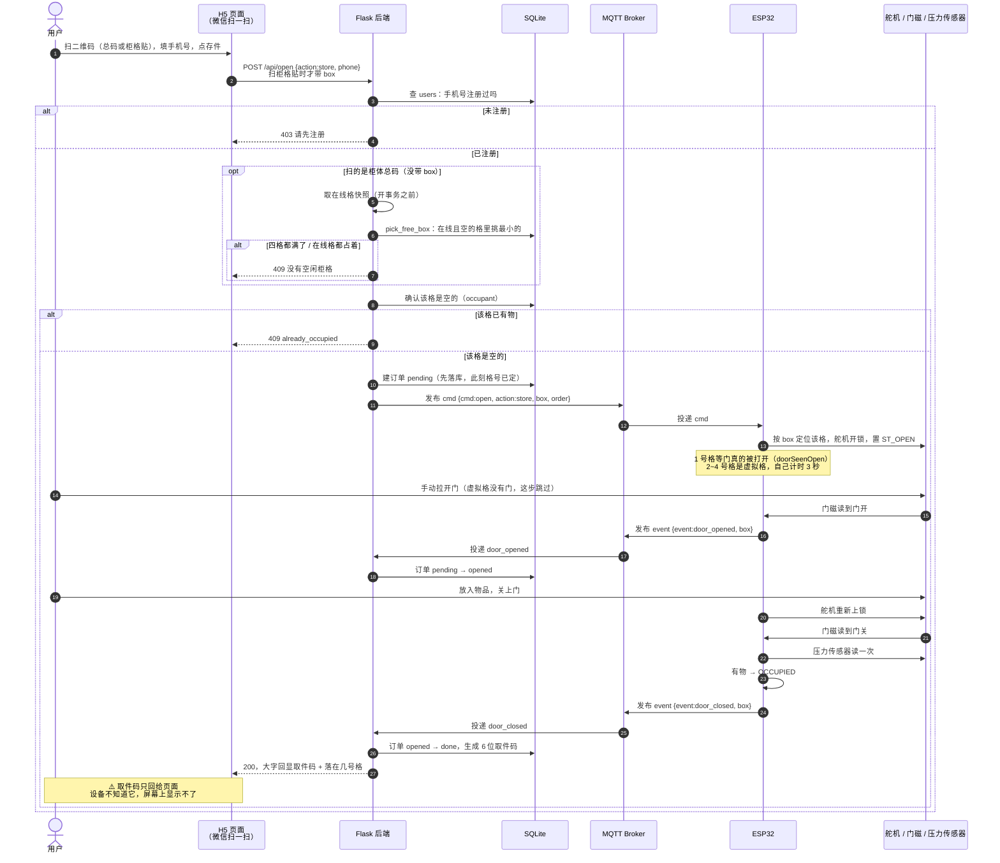
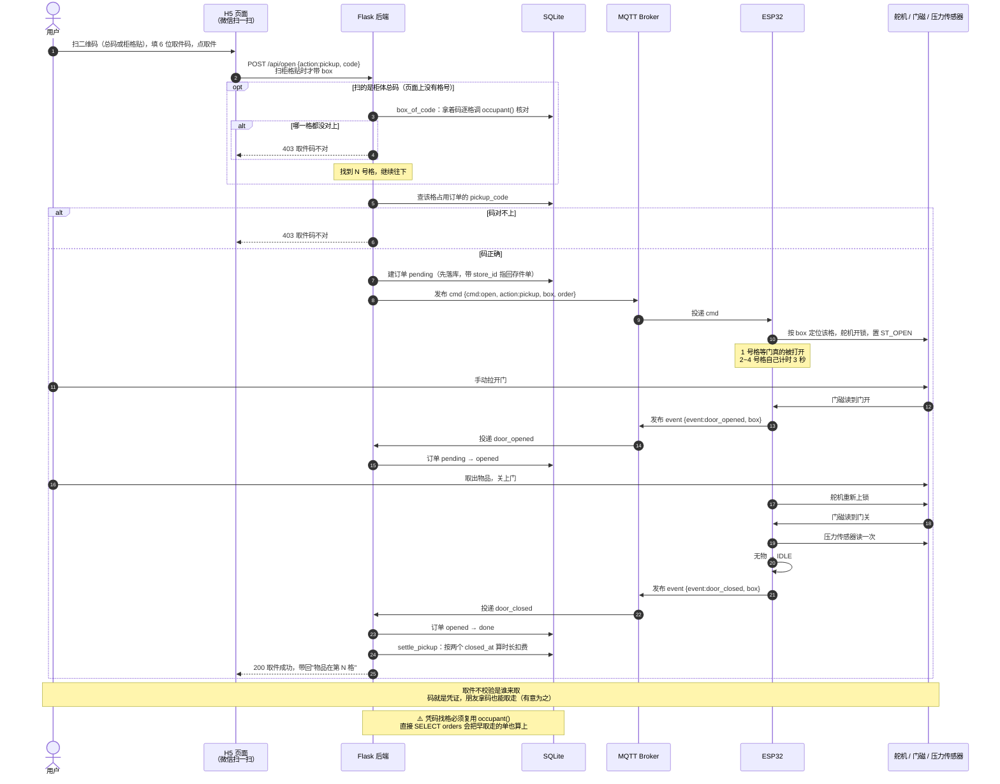
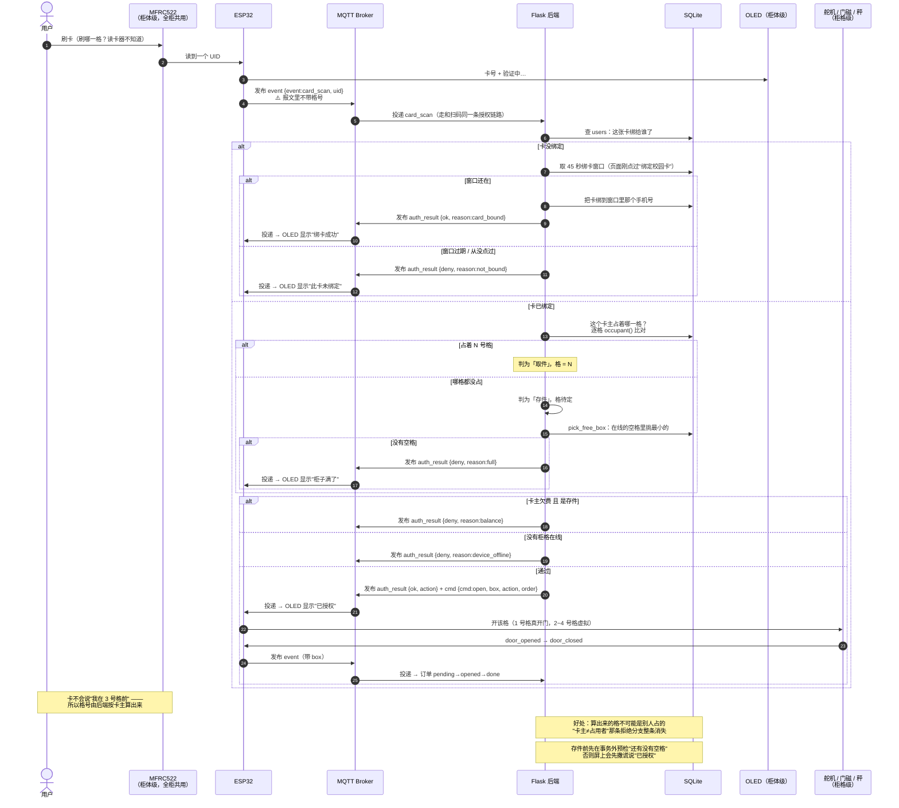

# 校园智能寄存柜 — 图源文件（Mermaid）

> 课程设计原型　|　技术路线：ESP32 ＋ MFRC522 校园卡识别 ＋ SG90 舵机 ＋ 干簧管门磁 ＋ HX711 压力传感器 ＋ 0.96″ OLED ＋ MQTT ＋ Flask ＋ SQLite
>
> 本文件与 `index.html` 中的图一一对应（图 6 / 图 7 两张时序图只有本文档版本）。
> 渲染：VS Code 装 `Markdown Preview Mermaid Support` 插件，或粘到 <https://mermaid.live> 导出 SVG/PNG。

**目录**

| 编号 | 图名 | 对应 index.html |
|---|---|---|
| 图 1 | 系统工作原理图 | 图 1 |
| 图 2 | 系统总体架构图 | 图 2 |
| 图 3 | 存取件业务流程图 | 图 3 |
| 图 4 | 柜格状态机（设备端） | 图 4 |
| 图 5 | 订单状态机（后端） | 图 5 |
| 图 6 | 存件时序图 | — |
| 图 7 | 取件时序图 | — |
| 图 8 | 刷卡时序图 | — |

> 与旧版的差别：技术路线补上了 **HX711 压力传感器**与 **OLED**；「微信小程序」订正为
> **微信扫一扫打开的 H5 页面**；新增 **图 5 订单状态机**；时序图从一张拆成存件 / 取件两张。
>
> **2026-10-14 多格改动**：柜子做成 **4 格**，其中 **只有 1 号格接了真硬件**
> （舵机 / 门磁 / HX711），2~4 号格由固件虚拟；新增**柜体总码**（自动挑格 / 凭码找格）与
> **刷卡自动定格**；图 3 补上挑格判定、图 2 的凭证说明改写、新增 **图 8 刷卡时序图**。

---

## 图 1　系统工作原理图

> **柜子是 4 格，但硬件只够一格。** 上面「现场设备侧」那一筐（舵机 / 门磁 / 秤 / 屏）
> 都是按 **1 号格**画的：一台 ESP32 上跑一块固件，**舵机 / 门磁 / HX711 属于柜格级**
> （每格一套，只有 1 号格装了），**RC522 / OLED / ESP32 属于柜体级**（全柜共用一套）——
> 所以读卡器**不知道**你站在哪一格前，"刷哪一格"是后端按卡主算的（见图 8）。
> 2~4 号格由固件虚拟出同样的状态和开门时序，报文格式与真机完全一致。

> **两条入口、一套判定**
> 扫码路径：微信扫柜贴二维码 → H5 页面 → `POST /api/open` → Flask。
> 刷卡路径：卡片 → MFRC522 读 UID → ESP32 发 `card_scan` → Flask。
> 两条路径在 Flask 汇合，共用同一套授权判定，再经 MQTT 下发 `cmd`。
>
> **闭环的关键是门磁**：后端不因为"命令发出去了"就认为存取成功，
> 必须等到设备回 `door_opened` / `door_closed` 才算数。

---

## 图 2　系统总体架构图

> **数据流向**
> 上行：设备层 → 传输层 → 后端层 → 交互层（`status`、`event`、`card_scan`）
> 下行：交互层 → 后端层 → 传输层 → 设备层（`cmd`、`auth_result`）
>
> **三种凭证，三条判定**（详见「授权（防越权）」一节）：
> H5 存件看**手机号**是否注册过（格号可省 —— 扫总码时由后端挑一个在线空格）；
> H5 取件看**6 位取件码**能不能对上某一格里那件东西（扫总码时连格号都是凭码解出来的）；
> 刷卡看**卡主是不是占着某一格** —— 占着就取那一格，没占就从在线空格里挑一格存
> （报文的格号被忽略，理由见上：读卡器是柜体级的）。
>
> 三条路最后都归一成同一个问题：**这一格里现在是空的吗** —— 由 `occupant()` 一个函数
> 回答，全项目没有第二个口径。

---

## 图 3　存取件业务流程图

```mermaid
flowchart TD
    S(["开始：用户在柜前扫码<br/>总码 /scan 或柜格贴 /scan?box=N"]) --> C0{"要做什么？"}

    C0 -- "存件" --> A1["在 H5 填手机号"]
    C0 -- "取件" --> A2["在 H5 填 6 位取件码"]

    A1 --> C1{"手机号已注册？"}
    C1 -- "否" --> D1["拒绝 403<br/>提示先注册"]
    C1 -- "是" --> C1B{"扫的是柜格贴？<br/>（带了 box）"}
    C1B -- "是" --> C2
    C1B -- "否（总码）" --> B1["从「在线且空」的格里挑一格<br/>pick_free_box()<br/>规则：格号最小的那个"]
    B1 --> B2{"还有空格吗？"}
    B2 -- "否" --> D2B["拒绝 409<br/>没有空闲柜格"]
    B2 -- "是" --> C2{"挑中的那一格是空的？"}
    C2 -- "否（已有物）" --> D2["拒绝 409<br/>already_occupied"]
    C2 -- "是" --> OK

    A2 --> C3A{"扫的是柜格贴？"}
    C3A -- "是" --> C3{"取件码 == 该格占用订单的码？"}
    C3A -- "否（总码，页面上没有格号）" --> B3["凭码在每一格里找<br/>box_of_code()"]
    B3 --> B4{"找到了吗？"}
    B4 -- "哪格都没有" --> D3["拒绝 403<br/>取件码不对"]
    B4 -- "找到 N 号格" --> C3
    C3 -- "否" --> D3
    C3 -- "是" --> C4{"该格有物？"}
    C4 -- "否（空柜）" --> D4["拒绝 409<br/>nothing_to_pickup"]
    C4 -- "是" --> OK

    OK["建订单 pending（先落库）<br/>再经 MQTT 下发 cmd:open<br/>此刻才确定格号"] --> I2["设备收到 cmd<br/>按报文里的 box 定位<br/>防呆复检 → 舵机开锁<br/>置该格 ST_OPEN"]
    I2 --> C5{"门真的被打开了吗？<br/>doorSeenOpen<br/>（1 号格才有；虚拟格自己计时）"}
    C5 -- "15s 内没有" --> D5["订单判 failed<br/>OPEN_ACK_TIMEOUT"]
    C5 -- "是 → 回 door_opened（带格号）" --> I3["订单转 opened<br/>用户放入 / 取出物品"]
    I3 --> C6{"门关上了吗？"}
    C6 -- "60s 内没有" --> D6["订单判 failed<br/>OPEN_CLOSE_TIMEOUT<br/>设备另报 door_left_open"]
    C6 -- "是 → 回 door_closed（带格号）" --> I4["设备判该格状态<br/>1 号格读压力传感器<br/>虚拟格按动作直接置位"]
    I4 --> I5["订单 done，落库<br/>写审计日志"]
    I5 --> C7{"是存件吗？"}
    C7 -- "是" --> I6["生成 6 位取件码<br/>大字回显给用户"]
    C7 -- "否" --> E(["结束"])
    I6 --> E

    style S  fill:#DB2777,stroke:#9D174D,color:#FFFFFF
    style E  fill:#DB2777,stroke:#9D174D,color:#FFFFFF
    style C0 fill:#FFFBEB,stroke:#F59E0B,color:#B45309
    style C1 fill:#FFFBEB,stroke:#F59E0B,color:#B45309
    style C1B fill:#FFFBEB,stroke:#F59E0B,color:#B45309
    style B2 fill:#FFFBEB,stroke:#F59E0B,color:#B45309
    style C2 fill:#FFFBEB,stroke:#F59E0B,color:#B45309
    style C3A fill:#FFFBEB,stroke:#F59E0B,color:#B45309
    style B4 fill:#FFFBEB,stroke:#F59E0B,color:#B45309
    style C3 fill:#FFFBEB,stroke:#F59E0B,color:#B45309
    style C4 fill:#FFFBEB,stroke:#F59E0B,color:#B45309
    style C5 fill:#FFFBEB,stroke:#F59E0B,color:#B45309
    style C6 fill:#FFFBEB,stroke:#F59E0B,color:#B45309
    style C7 fill:#FFFBEB,stroke:#F59E0B,color:#B45309
    style A1 fill:#EFF6FF,stroke:#2563EB
    style A2 fill:#EFF6FF,stroke:#2563EB
    style B1 fill:#ECFDF5,stroke:#0D9488,color:#0F766E
    style B3 fill:#ECFDF5,stroke:#0D9488,color:#0F766E
    style I2 fill:#EFF6FF,stroke:#2563EB
    style I3 fill:#EFF6FF,stroke:#2563EB
    style I4 fill:#EFF6FF,stroke:#2563EB
    style OK fill:#FFF7ED,stroke:#EA580C
    style I5 fill:#FFF7ED,stroke:#EA580C
    style I6 fill:#FFF7ED,stroke:#EA580C
    style D1 fill:#FEF2F2,stroke:#FCA5A5,color:#B91C1C
    style D2 fill:#FEF2F2,stroke:#FCA5A5,color:#B91C1C
    style D2B fill:#FEF2F2,stroke:#FCA5A5,color:#B91C1C
    style D3 fill:#FEF2F2,stroke:#FCA5A5,color:#B91C1C
    style D4 fill:#FEF2F2,stroke:#FCA5A5,color:#B91C1C
    style D5 fill:#FEF2F2,stroke:#FCA5A5,color:#B91C1C
    style D6 fill:#FEF2F2,stroke:#FCA5A5,color:#B91C1C
```

> **⚠️ 两个决策点是全系统的要害**
> ④ 防越权：凭证对不上直接拒，且记审计 —— 别人拿不走你的东西。
> ⑦ 防执行失败：**门磁说了算**。命令发出不等于柜门开了，更不等于东西放进去了。
>
> **⚠️ 格号是在流程里"长出来"的，不是用户填的。** 扫总码时页面上根本没有格号：
> 存件由 `pick_free_box()` 从**在线的空格**里挑一个（最小的），取件由 `box_of_code()`
> 拿着码去每一格核对。所以 `box` 这个参数是**可选**的，而**一旦传了就必须真存在 ——
> 非法格号一律 400/404，绝不静默回落到 1 号格**（否则"扫 3 号格、开 1 号格的门"
> 这类错事后谁都查不出来）。
>
> **挑格前必须先取一张"在线格快照"**，且要在开事务之前取：`device_online()` 要拿进程锁，
> 而建单事务正握着 DB 写锁，持写锁再等进程锁是锁序倒置。
>
> **⚠️ 关门回执之前，门必须真的被打开过**（固件里的 `doorSeenOpen`）。
> 舵机开锁 ≠ 门被打开：若门一直关着，程序下一轮就会把"锁已开"误判成"门关了"，
> 订单 1 秒就 `done`，而东西还没放进去。

---

## 图 4　柜格状态机（设备端）

> **⚠️ 这里只有三个状态，网上常见的第四个 `ERROR` 在本项目是死代码。**
> 固件里 `ST_ERROR` 仅作枚举占位，代码不会进入它 —— 后端靠自己的超时判 `failed` 来兜"执行失败"，
> 设备端不需要故障态。硬要启用会出事：关门分支的条件是 `boxState == ST_OPEN && !doorOpen()`，
> 一旦进了 `ST_ERROR` 就再也匹配不上，状态会永久卡死，只能重启。
>
> **上电初态不是固定的**：固件读一次压力传感器，按实况落到 `IDLE` 或 `OCCUPIED`，
> 避免断电恢复后状态错乱。
>
> **⚠️ 这套状态机是「每一格各一份」**（固件里是 `Box boxes[BOX_COUNT]`），四格各跑各的，
> 互不影响。区别在"门真的被打开了吗"这一步怎么判定：
>
> - **1 号格**：有真簧片，`doorSeenOpen` 防呆照常 —— 没见过门开就不认门关。
> - **2~4 号格**：没有硬件可读，`doOpen()` 走另一条分支，设一个 `closeAt = now + 3s`，
>   到点自己发 `door_opened` 再发 `door_closed`，格内有无按动作直接置位。
>   报文格式与真机**完全一致**，后端一行都没改。
>
> 上电初态那段同理只对 1 号格有意义（它有秤可读），虚拟格一律 `IDLE / 无物`。

---

## 图 5　订单状态机（后端）

> **为什么 `done` 要等门磁回执**：后端不因为"命令发出去了"就认为存取成功 ——
> 设备可能根本没开门，或者开了没人关门。`pending` 15 秒、`opened` 60 秒是两个兜底超时
> （可用环境变量 `OPEN_ACK_TIMEOUT` / `OPEN_CLOSE_TIMEOUT` 调），超时一律判 `failed`。
>
> **另有一处细节**：命令**先落库再 publish**。设备最快毫秒级就回 `door_opened`，
> 如果那时订单还没写进去，事件线程就不知道这条回执属于谁。
>
> **⚠️ 已知缺口**：门磁回执里只有**格号**，没有订单号，所以
> `advance(box, from, to)` 是"先在这一格里挑最新的那张单、再条件 UPDATE"。
> 同一格上若有一条迟到的 `door_closed`，而该格此刻恰有另一张在 `opened` 的单，
> 就会推错单。要修得让固件把 `cmd` 里的 `order` 原样回传、`advance()` 改成按 `id` 推进
> —— 本次没做，只记在 README 的「已知缺口」里。

---

## 图 6　存件时序图

> **`box` 在报文里是"可选但一旦给了就必须真存在"**：不带 = 扫总码，由后端挑/找；
> 带了但不是 1~4 → 400，**不回落**。

---

## 图 7　取件时序图

> **两种码都不泄漏"哪些码是真的"**：找不到格和"格是空的"回的是**同一句话、同一个状态码**
> （403 取件码不对）。存件码只有 6 位，分开报等于给别人一个枚举的口子。

---

## 图 8　刷卡时序图

> **固件不认识"订单"**：它只按 `cmd` 里的 `box` 开那一格，然后如实回报门开没开。
> `cmd` 里其实带着 `order`，但**固件没有把它带回回执** —— 这是「已知缺口」里的
> `advance()` 那条（回执没有订单号，后端只能按格号推进）。

---

## 图源修改速查

| 想改什么 | 改哪里 |
|---|---|
| MQTT 主题 | 图 1 `MQTT` 节点、图 2 `N2` |
| GPIO 接线 | 图 1 设备侧各节点说明、图 2 `L1` |
| 柜格数 / 真格与虚拟格 | 图 1 说明段、图 2 `S2`–`S7`、图 4 说明段 |
| 后端功能模块 | 图 2 `L3` 内的 P1–P6 |
| 授权规则（三种凭证） | 图 3 `C1`/`C3A`/`C3`、图 8 各 `alt` 分支、图 2 `SEC` |
| 挑格 / 找格规则 | 图 3 `B1`–`B4`、图 6 / 图 7 的 `opt` 块 |
| 柜格状态迁移条件 | 图 4 各条 `-->` 的标签 |
| 订单超时阈值 | 图 3 `D5`/`D6`、图 5 两条 `failed` 迁移 |
| 时序步骤 | 图 6 / 图 7 / 图 8 的 `->>` 行 |
| 配色 | 各 `style` 行，与 `index.html` 中 `:root` 变量一致 |
