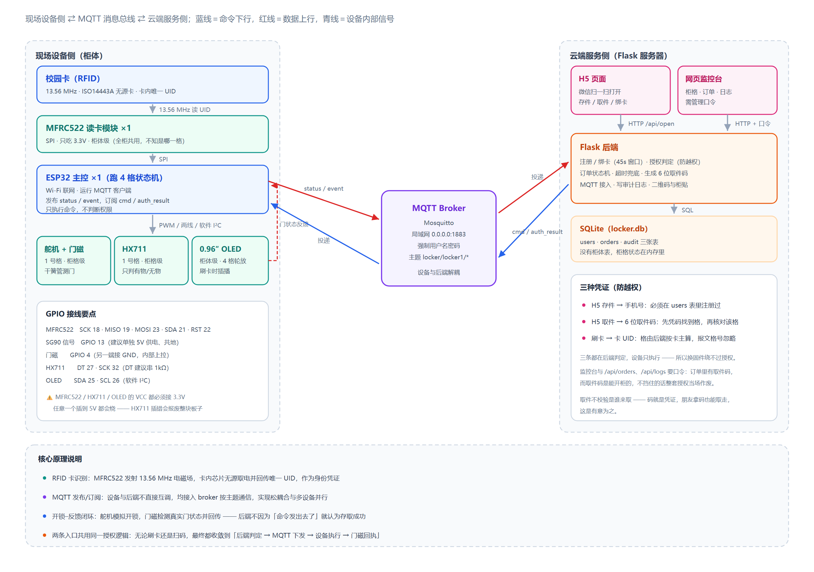
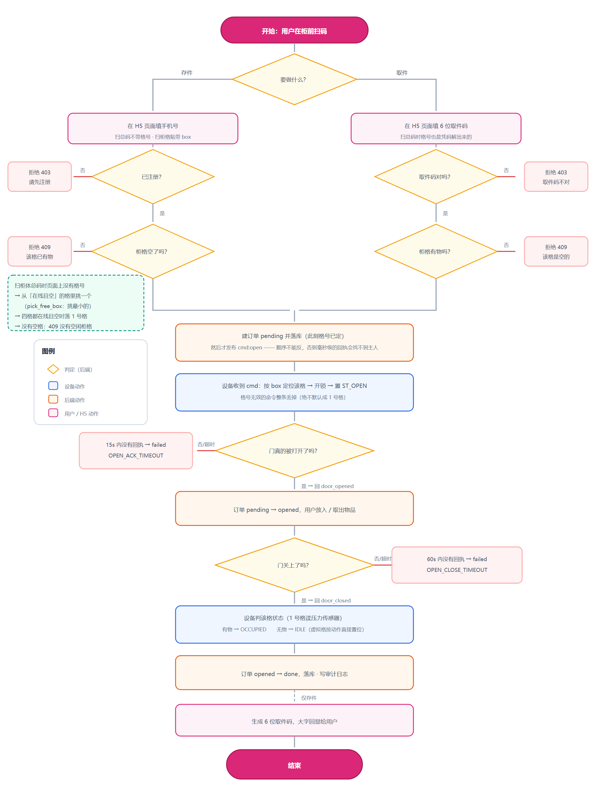
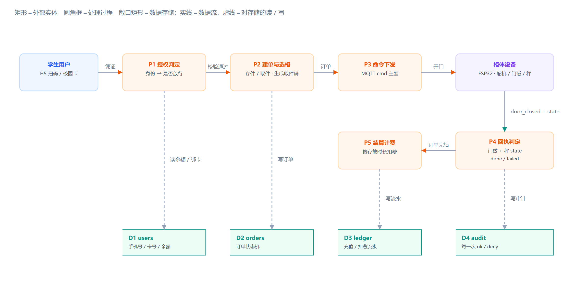
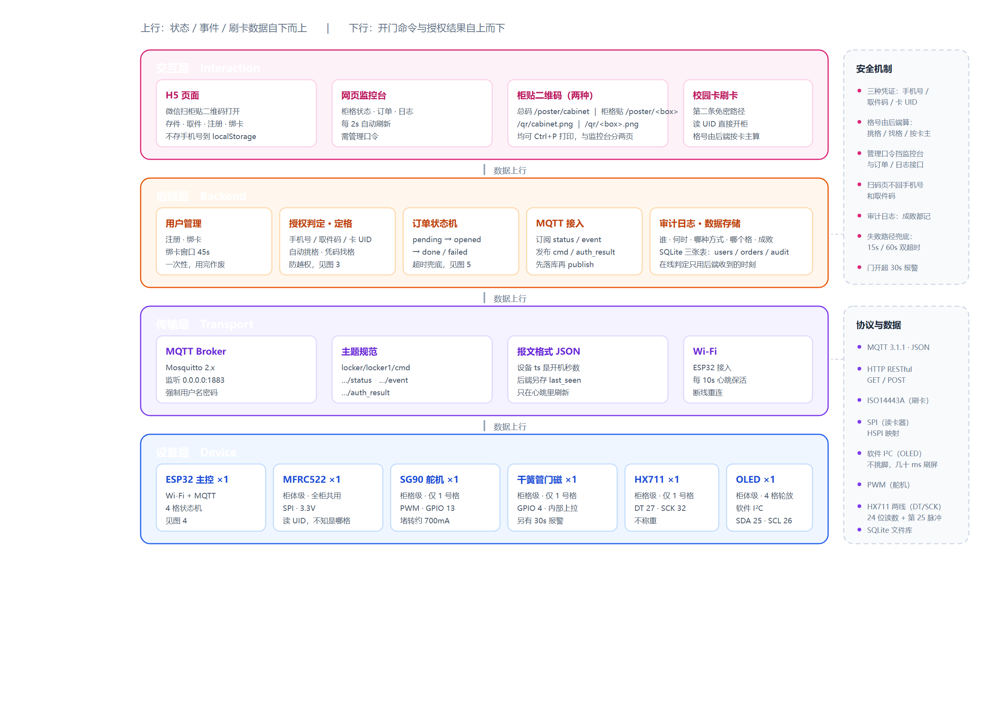
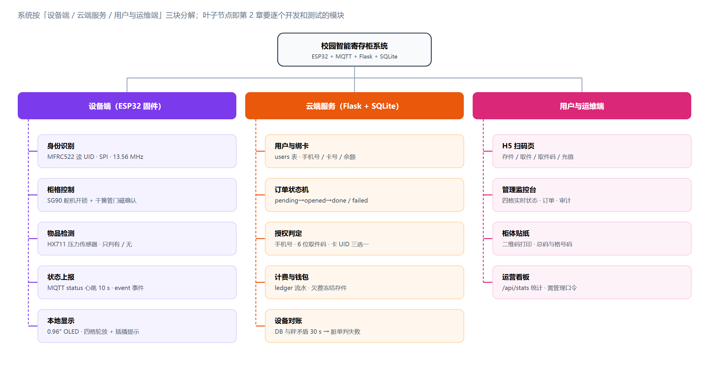
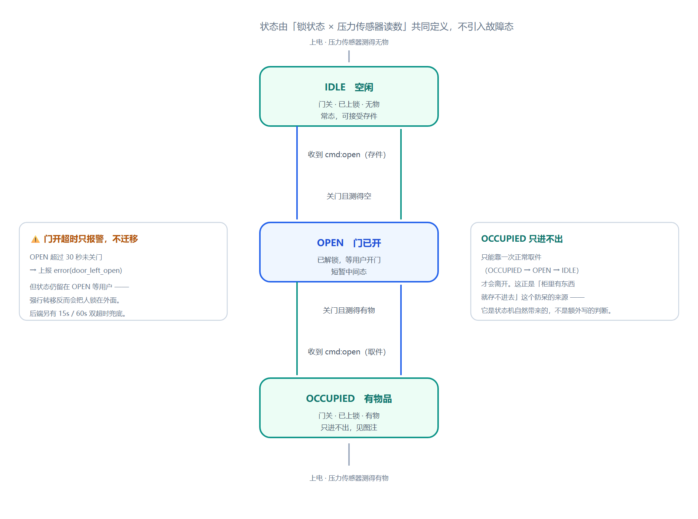
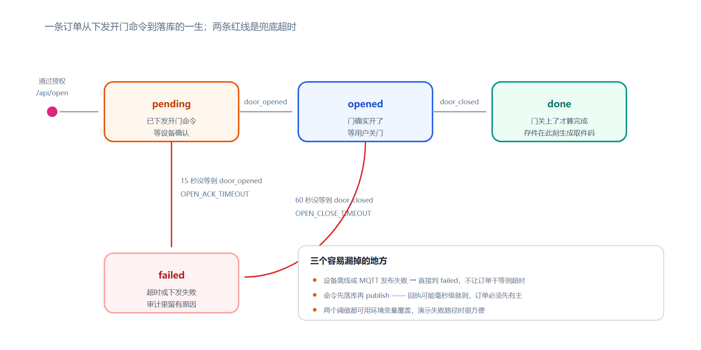
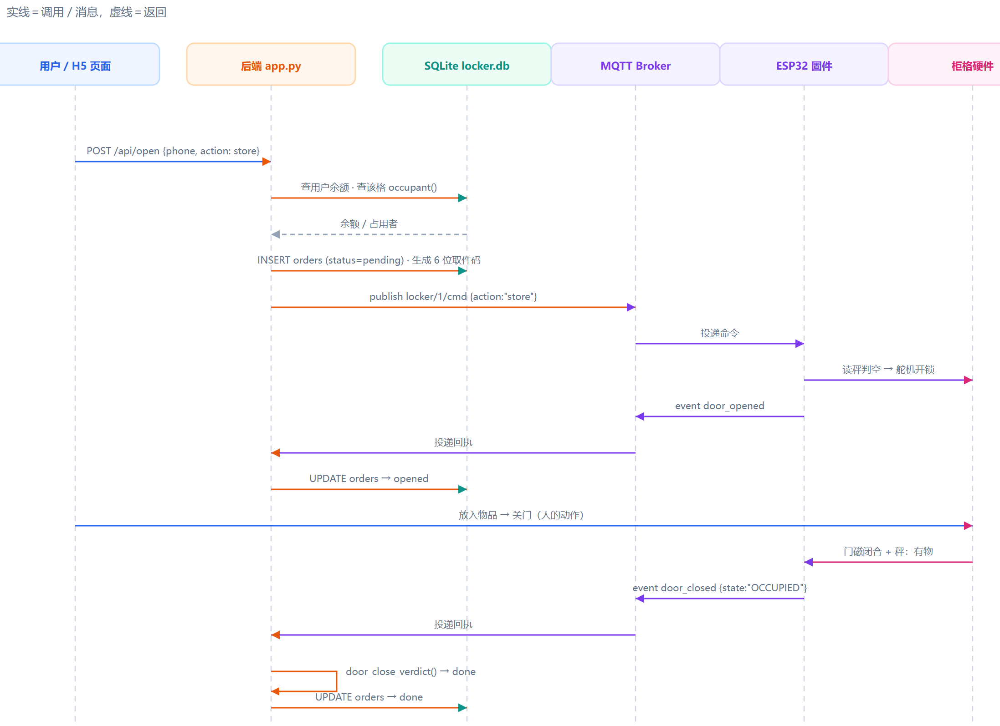
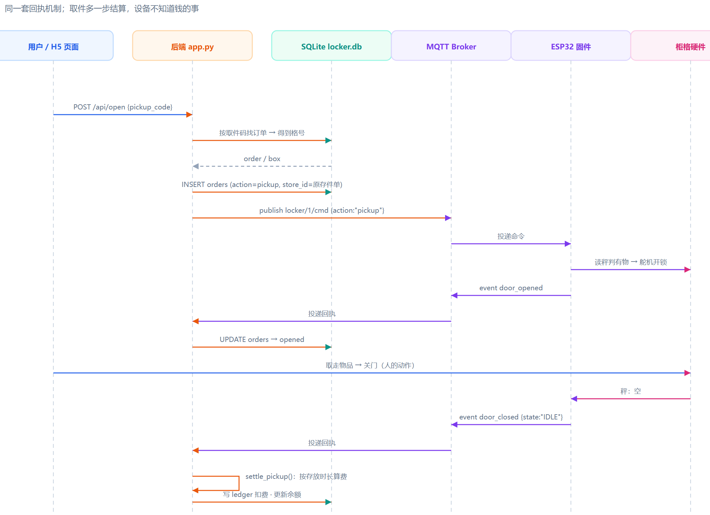
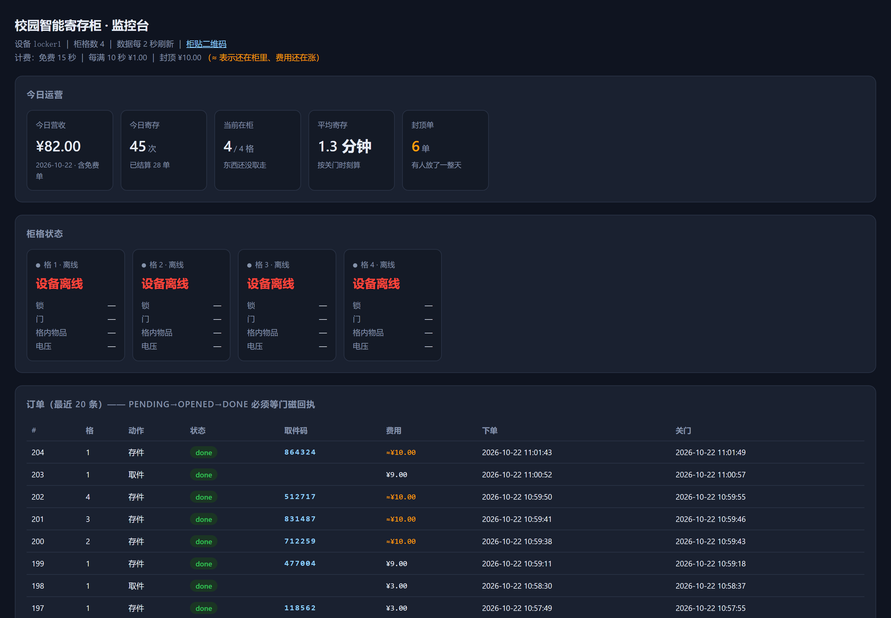

## 实验名称：智能寄存柜管理系统实验


---

## 摘要

本实验设计并实现了一套面向校园场景的智能寄存柜原型系统。系统以 ESP32 为主控，集成 MFRC522 射频读卡、SG90 舵机锁、干簧管门磁与 HX711 压力传感器，构成现场设备侧；以 MQTT 为消息总线，连接 Flask 后端与 SQLite 数据库构成云端服务侧；以微信扫码 H5 页面和管理监控台构成用户侧。系统实现了扫码存件、扫码取件、刷卡免密存取、按存放时长计费、欠费冻结、多柜格调度、设备状态实时上报与异常对账等完整功能，并在真实硬件上完成了全链路联调与测试。

本实验的重点不在"把柜子做出来"，而在**如何让一个不可靠的物理世界与一个要求确定的软件系统对齐**：开锁成功不等于存件成功，门被打开不等于门被关上，传感器读数也不总是可信。围绕这些矛盾，系统设计了"门磁回执 + 称重状态"双重确认机制、订单状态机与超时兜底机制、数据库与传感器对账机制，并在真机上逐一验证。

**关键词**：ESP32；MQTT；物联网；状态机；RFID；称重传感器

---

# 1 系统分析与设计

## 1.1 系统分析

### 1.1.1 应用场景与需求分析

**场景设定**：校园图书馆、教学楼、体育馆入口处常需要临时寄存书包、雨具、实验器材。传统人工寄存依赖管理员，无法 24 小时服务；商用寄存柜多为离线单机设备，无法与校园卡、微信等已有身份体系打通，也无法按占用时长计费。

**用户故事**：学生用手机扫描柜体上的二维码，在 H5 页面选择"存件"，柜门自动弹开，放入物品关门后页面给出 6 位取件码；返回时输入取件码，柜门打开，取出物品关门，系统按存放时长从钱包扣费。

由此提炼出**功能需求**：

| 编号 | 需求 | 说明 |
|---|---|---|
| F1 | 身份认证 | 支持微信扫码（手机号）与校园卡（RFID）两条入口 |
| F2 | 存取控制 | 存件自动分配空柜格，取件凭 6 位取件码或已绑定的卡 |
| F3 | 执行确认 | 必须确认"门真的开了、东西真的放进去 / 拿走了"，不能只看命令发出 |
| F4 | 计费与钱包 | 按存放时长计费，支持充值、欠费冻结 |
| F5 | 状态监控 | 运维端实时查看四格状态、订单与审计日志 |

**非功能需求**：单次操作响应在秒级；设备掉线、命令丢失、传感器误读等异常不能导致数据错乱；整套硬件成本控制在百元级；必须能支持后续扩展到更多柜格。

其中 **F3 是本系统的核心难点**。若只以"命令已下发"判成功，用户开门后什么都没放就关门，系统会生成一条虚假存件记录并发出取件码，该柜格随即被永久占用——这正是许多同类课程设计作品在演示时"格子里明明没东西却显示已占用"的根源。

### 1.1.2 系统工作原理

系统由**现场设备侧**、**MQTT 消息总线**、**云端服务侧**三部分组成，如图 1 所示。



**图 1　系统工作原理图**

现场设备侧以 ESP32 为主控，挂载四类外设：

- **MFRC522 读卡模块**：13.56 MHz 磁场耦合，为无源卡提供能量并读取其唯一 UID，作为刷卡身份凭证。读卡器是**柜体级**器件，全柜共用一只，它并不知道用户站在哪一格前。
- **SG90 舵机**：PWM 驱动，转动模拟开锁动作，是系统的"执行器"。
- **干簧管门磁开关**：磁性接近开关，检测门是否真的被拉开，是系统的"执行结果反馈"。
- **HX711 + 称重传感器**：24 位 ADC 读取应变片电阻变化，判断格内有无物品，是系统的"业务结果反馈"。
- **0.96 英寸 SSD1306 OLED**：本地状态显示，四格轮放。

云端服务侧以 Flask 提供 HTTP 接口，背后是 SQLite 数据库。两端**不直接通信**，全部通过 MQTT Broker 按主题收发消息，实现松耦合。

**核心原理**可以概括为一句话：**"命令下行 → 设备执行 → 状态回传 → 后端判定"的闭环**。后端从不因为"我把命令发出去了"就认为操作成功，它等待设备回传的门磁与称重数据，据此判定这一单的成败。

系统中存在两条并行的身份入口（扫码与刷卡），但只有**一套授权判定逻辑**，全部在后端完成：

- H5 存件 → 手机号必须在 `users` 表中注册过；
- H5 取件 → 6 位取件码必须能唯一找到一条 `done` 状态的存件单，且格号一致；
- 刷卡 → 卡 UID 由后端按卡反查用户，报文中携带的格号一律忽略。

设备端只负责执行，**不做任何权限判断**——这是刻意的设计：即使有人劫持了设备，也无法绕过服务端的授权。

### 1.1.3 存取件业务流程分析

完整的业务流程如图 2 所示。



**图 2　存取件业务流程图**

**存件流程**：

1. 用户扫码进入 H5，选择存件，提交手机号；
2. 后端校验用户已注册、余额未欠费，调用 `pick_free_box()` 挑选一个空闲柜格；
3. 后端生成 6 位取件码，写入一条 `pending` 状态的订单，向该格的命令主题发布开门指令；
4. 设备收到命令，**先读秤确认格内无物**，再驱动舵机开锁，回传 `door_opened`；
5. 用户放入物品、关门，设备读取门磁与称重结果，回传 `door_closed` 事件并**附带格内状态**；
6. 后端依据该状态判定订单为 `done` 或 `failed`，页面展示取件码。

**取件流程**：

1. 用户输入取件码；
2. 后端按码查找订单，得到格号，核对格内确实有物；
3. 后端创建取件单（通过 `store_id` 指回原存件单），下发开门命令；
4. 设备确认格内有物后开锁，回传 `door_opened`；
5. 用户取走物品关门，设备回传 `door_closed`（此时应为"空"）；
6. 后端结算费用、写钱包流水、更新余额。

**刷卡路径**与上类似，区别仅在于第 1 步：读卡器读到 UID 后上报 `card_scan`，后端反查用户，随后自动判断该用户当前应做存件还是取件（柜内有其物品则取件，否则存件）。

### 1.1.4 数据流分析

系统的数据流如图 3 所示，采用自顶向下分解的表达方式：矩形为外部实体，圆角框为处理过程，敞口矩形为数据存储。



**图 3　数据流图**

- **P1 授权判定**：接收来自用户的凭证（手机号 / 取件码 / 卡 UID），读取 `users` 表，输出"是否放行"；
- **P2 建单与选格**：为通过的请求挑选空柜格、生成取件码，向 `orders` 表写入 `pending` 订单，并把订单交出去；
- **P3 命令下发**：将订单转换为 MQTT 命令报文，发布到对应柜格的主题；
- **P4 回执判定**：接收设备回传的门磁与称重状态，更新订单为 `done` 或 `failed`，把每一次判定写入 `audit`；
- **P5 结算计费**：对已完结的取件单按存放时长计算费用，写 `ledger` 流水并更新余额。

四个数据存储分别是用户表、订单表、钱包流水表与审计表。需要特别指出的是：**柜格本身不是一个数据表**。"这一格里有没有东西"这个事实只存在于两处——设备内存中的 `state`，以及后端通过"该格最近一条 `done` 存件单"推得的占用关系。两者一旦分家，就会出现 3.1 节所述的联调问题。

## 1.2 系统设计

### 1.2.1 系统总体架构

系统的四层架构如图 4 所示。



**图 4　系统总体架构图**

- **感知层**：卡片、按键（H5）、门磁、称重传感器，负责把物理世界的状态转换为电信号；
- **网络层**：ESP32 的 Wi-Fi 与 MQTT 客户端，负责把电信号转换为消息；
- **平台层**：Flask + SQLite，负责业务逻辑、状态机、数据持久化；
- **应用层**：H5 扫码页、管理监控台、柜体贴纸二维码，面向最终用户与运维人员。

选择 MQTT 而非 HTTP 作为设备通信协议，原因有三：设备需要**被动接收**服务端指令（HTTP 下设备需轮询，实时性差且耗电）；MQTT 长连接天然支持断线重连与心跳；发布/订阅模型让后端不必知道设备 IP，换网络只需设备重新连上 Broker。

### 1.2.2 功能框图

系统按三个子系统分解，共 14 个功能模块，如图 5 所示。图中每一个叶子节点，都是第 2 章中单独开发并测试的单元。



**图 5　功能框图**

### 1.2.3 柜格状态机设计（设备端）

设备端为每个柜格维护一个状态机，共三个有效状态，如图 6 所示。



**图 6　柜格状态机（设备端）**

- `IDLE`（空闲）：门关着，格内无物；
- `OPEN`（已开门）：舵机已解锁，等待门被真正打开；
- `OCCUPIED`（已占用）：门已关上，格内有物。

设计中有四条必须守住的规则：

1. **`doorSeenOpen` 标志**。仅凭"舵机转过"或"门磁现在是关的"都不足以判定用户完成了操作。程序要求门磁**先被读到打开过**，之后读到闭合，才认为完成一次存取。这条规则来自一次真实故障：早期版本中，命令下发后门磁一直是"关"，程序立刻判定完成，订单在 1 秒内就变成 `done`，而用户根本没碰过门。
2. **舵机开锁 ≠ 门被打开**。舵机只是解除机械约束，用户可能根本没有拉门。因此 `OPEN` 状态必须等待门磁确认。
3. **防呆判据读秤，不读缓存状态**。`doOpen()` 在开锁前要判断"这格能不能存 / 能不能取"。最初它读取的是内存中的 `b.state`，后来发现该状态可能因后端对账而与事实不符，导致"格子明明空着却拒绝存件"。现改为**直接读取称重传感器的实时读数**——格内有无物品，秤是唯一的事实。
4. **不启用错误状态**。枚举中保留了 `ST_ERROR`，但代码从不进入该状态。因为状态机一旦进入错误态，后续的门磁判据将永远无法匹配，状态会永久卡死。执行失败的兜底交由后端超时机制完成。

### 1.2.4 订单状态机设计（后端）

后端为每一笔操作维护一个订单，四状态，如图 7 所示。



**图 7　订单状态机（后端）**

- `pending`：已下单，命令已发出，等待设备确认开门；
- `opened`：设备回传 `door_opened`，门已打开，等待关门回执；
- `done`：关门回执经判定成功，业务完成；
- `failed`：判定失败，包括门未开、超时未关门、关门后格内状态与动作不符三种情况。

两个关键设计点：

**其一，超时兜底**。订单停留在 `pending` 或 `opened` 超过 `OPEN_CLOSE_TIMEOUT`（默认 60 秒），后台清扫线程 `sweeper()` 会将其置为 `failed` 并释放柜格。否则设备掉线时订单会永久挂起，柜格被"锁死"。

**其二，判定函数独立**。关门回执的成败判定集中在 `door_close_verdict()` 一个函数中：存件单要求格内状态为 `OCCUPIED`，取件单要求为 `IDLE`，其余一律 `failed`。若回执中未携带状态字段（旧固件），则该函数返回 `None`，系统退回"门关了就算成功"的旧行为，保证协议向后兼容。

### 1.2.5 关键流程时序设计

存件与取件的完整消息时序分别如图 8、图 9 所示。



**图 8　存件时序图（开锁成功不等于存件成功，只有秤说了算）**



**图 9　取件时序图（计费全在后端，固件一行没改）**

从图中可以看出两个设计意图：

1. **取件码在开门时就已生成并写入订单**，而不是等到关门确认后才生成。这样即使"存空"导致订单失败，取件码也已经存在于数据库中，但该订单状态为 `failed`，凭此码取件会被服务端拒绝（返回 409）。**取件码不是通行证，订单状态才是。**
2. **计费完全发生在后端**。设备侧代码中没有任何金额、时长相关的逻辑，它只回答"格内有没有东西"。这使得计费规则可以在不重新烧录固件的前提下任意调整。

### 1.2.6 数据库设计

数据库采用 SQLite，共四张表。选型理由是：本系统为单机原型，写入并发极低，SQLite 无需独立进程、零配置、单文件即可备份，适合课程设计与小型部署。

**表 1　users（用户与卡绑定）**

| 字段 | 类型 | 说明 |
|---|---|---|
| id | INTEGER PK | 自增主键 |
| name | TEXT | 姓名 |
| phone | TEXT UNIQUE | 手机号，H5 入口的凭证 |
| card_uid | TEXT UNIQUE | 校园卡 UID，刷卡入口的凭证 |
| balance_fen | INTEGER | 余额，单位「分」，整数运算 |

**表 2　orders（订单）**

| 字段 | 类型 | 说明 |
|---|---|---|
| id | INTEGER PK | 订单号 |
| box | INTEGER | 柜格号 |
| phone | TEXT | 归属用户 |
| action | TEXT | store / pickup |
| status | TEXT | pending / opened / done / failed |
| pickup_code | TEXT | 6 位取件码，存件时生成 |
| created_at / closed_at | TEXT | 下单时间 / 关门时间 |
| store_id | INTEGER | 取件单指回它的存件单，计费据此算时长 |

**表 3　ledger（钱包流水）**

| 字段 | 类型 | 说明 |
|---|---|---|
| id | INTEGER PK | 流水号 |
| kind | TEXT | charge 扣费 / recharge 充值 |
| amount_fen | INTEGER | 有符号，充值为正、扣费为负 |
| balance_after_fen | INTEGER | 交易后余额 |
| order_id / store_id | INTEGER | 关联的取件单 / 存件单 |

`ledger` 表上建有唯一索引 `ux_ledger_charge_order ON ledger(order_id) WHERE kind='charge'`，保证**一条取件单只允许扣一次费**。这是为"进程在改状态与扣费之间被杀"这一场景准备的兜底。

**表 4　audit（审计日志）**

| 字段 | 类型 | 说明 |
|---|---|---|
| ts | TEXT | 时间戳 |
| source | TEXT | wechat / card / device / system / admin |
| action | TEXT | 动作类型 |
| result | TEXT | ok / deny |
| detail | TEXT | 人类可读的说明 |

审计表记录每一次放行与拒绝，是系统排障与事后追责的唯一依据。

**关于金额的工程约束**：全系统金额一律使用 `INTEGER` 存储"分"，禁止使用浮点数。浮点累加会产生 `0.1 + 0.2 = 0.30000000000000004` 这类误差，在涉及金钱与对账的系统里是不可接受的。

### 1.2.7 通信协议设计

MQTT 主题按下表设计，`DEVICE_ID` 默认为 `locker1`：

| 主题 | 方向 | 用途 |
|---|---|---|
| `locker/locker1/cmd` | 后端 → 设备 | 开门命令，含 action 与格号 |
| `locker/locker1/status` | 设备 → 后端 | 心跳，每 10 秒一次，携带四格状态 |
| `locker/locker1/event` | 设备 → 后端 | 事件：door_opened / door_closed / error / card_scan |
| `locker/locker1/auth_result` | 后端 → 设备 | 刷卡鉴权结果，供 OLED 显示 |

关键报文示例如下：

```json
// 下行：开门命令
{"action": "store", "box": 1}

// 上行：心跳（每 10 秒）
{"box": 1, "state": "IDLE", "locked": true,
 "door_open": false, "item": false, "ts": 1289}

// 上行：关门回执（state 是本系统的关键字段）
{"event": "door_closed", "box": 1, "state": "IDLE", "ts": 107}

// 上行：刷卡事件
{"event": "card_scan", "uid": "6B492D54", "ts": 51}
```

其中 `door_closed` 报文里的 `state` 字段是整个系统成败判定的**唯一依据**。若缺少该字段，后端将无法区分"存件成功"与"开了门什么都没放"。

---

# 2 单元模块开发与测试

系统按功能框图的三个子系统划分为三个模块分别开发：设备端固件、后端服务、用户端页面。每个模块独立开发、独立测试，最后进行系统集成。

## 2.1 模块一：设备端固件开发

### 2.1.1 模块职责与对外接口

设备端固件运行于 ESP32，使用 Arduino 框架开发，编译占用 Flash 约 90%、RAM 约 15%。

其职责边界十分清晰：**它只负责执行指令与上报事实，不做业务判断**。固件不保存订单、不知道价格、不知道用户是谁，甚至不知道取件码。

对外接口全部通过 MQTT 三个主题完成（见表 1.2.7 节）。内部则为四个柜格各维护一份状态，其中 1 号格接真实硬件，2~4 号格由固件"虚拟"——收到开门命令后自行演出 `door_opened` 与 `door_closed` 两个事件，用于在只有一套硬件的条件下验证后端的四格调度逻辑。

### 2.1.2 程序结构

固件由 21 个函数组成，按职责分为五组：

| 分组 | 函数 | 功能 |
|---|---|---|
| 传感器抽象 | `doorOpen()` / `itemPresent()` / `itemOf()` / `doorOpenOf()` | 把物理量抽象为布尔值，是业务层唯一的事实来源 |
| 称重驱动 | `hx711Read()` / `scaleSample()` / `scaleTare()` / `tickScale()` | HX711 时序、滑动平均、开机去皮、非阻塞采样 |
| 执行与显示 | `setLock()` / `drawOled()` / `oledToast()` / `tickOled()` | 舵机控制、OLED 状态页与插播提示 |
| 通信 | `publishStatus()` / `publishEvent()` / `onMqtt()` / `ensureMqtt()` | 心跳上报、事件上报、命令接收、断线重连 |
| 业务 | `doOpen()` / `handleCardScan()` / `setup()` / `loop()` | 开门防呆、刷卡轮询、初始化与主循环 |

**非阻塞设计**是主循环的关键约束：`tickScale()` 只在 HX711 数据就绪时读取一次，`tickOled()` 按时间片轮换显示，读取串口命令也是非阻塞的。整个 `loop()` 中唯一的阻塞调用是关门时 `setLock()` 内部的 `delay(400)`，用于等待舵机转到位。

### 2.1.3 关键代码

**（1）称重只判有/无，判据用差值**

压力传感器的读数只有相对意义，没有绝对零点，因此开机时先"去皮"——把当时的读数记为 `scaleZero`，此后以**差值**衡量是否放入物品：

```cpp
bool itemPresent() {
  if (!scaleReady) return false;   // 模块没读数，宁可判"无"
  return fabsf(scaleFiltered - (float)scaleZero) > (float)ITEM_THRESHOLD_COUNTS;
}
```

门限 `ITEM_THRESHOLD_COUNTS = 8000` 是实测确定的：空托盘噪声在 ±50 计数以内，放入一本书的读数为 −33395 计数，余量约 4.2 倍。

**（2）关门判定：重采样后再判定**

滑动平均有约 800 ms 的滞后，若直接用滤波值判定，读到的可能是"手还没离开托盘"时的读数。因此在关门后重新阻塞采样一组：

```cpp
if (real.state == ST_OPEN && real.doorSeenOpen && !doorOpen()) {
  delay(DOOR_SETTLE_MS);          // 400 ms 等门停稳
  if (!doorOpen()) {
    setLock(true);                // 上锁，内部再等 400 ms
    long v;
    if (scaleSample(v)) scaleFiltered = (float)v;   // 重新采一组
    real.state = itemPresent() ? ST_OCCUPIED : ST_IDLE;
    publishStatus(REAL_BOX);
    publishEvent(REAL_BOX, "door_closed", "state", stateName(real.state));
  }
}
```

注意最后一行：**关门回执必须携带 `state`**。这是全系统成败判定的数据来源。

**（3）开门防呆读秤**

```cpp
bool hasItem = itemPresent();            // 以秤为准，不读缓存的 b.state
if (wantStore && hasItem) {
  publishEvent(n, "error", "reason", "already_occupied");
  oledToast("无法开门", "这格已经有东西了", 3000);
  return;
}
if (!wantStore && !hasItem) {
  publishEvent(n, "error", "reason", "nothing_to_pickup");
  oledToast("无法开门", "这格是空的", 3000);
  return;
}
```

**（4）HX711 驱动的三个移植要点**

从单片机例程移植到 ESP32 时，有三处必须修改：读取必须加超时（原例程 `while(digitalRead(DT));` 在模块掉线时会永久卡死，且看门狗会在 5 秒后重启）；差值运算必须使用**有符号**类型（原例程用 `unsigned long`，读数低于零点时会回绕成约 42 亿，导致系统恒判"有物"，柜子从此再也取不走）；必须完整发送 25 个时钟脉冲并做 `count ^= 0x800000` 的符号位翻转。

### 2.1.4 调试过程与问题

**问题一：舵机开锁被误判为"门已打开"，订单 1 秒内完成**

现象：命令下发后，订单立即从 `opened` 变为 `done`，而用户尚未接触柜门。

定位：早期程序仅判断"门磁当前读数为关"，而门本来就一直是关的。

解决：引入 `doorSeenOpen` 标志，要求门磁**先读到打开、再读到闭合**。这暴露出一条重要经验：执行器动作不能作为执行结果的证据，只有传感器回传才能。

**问题二：门磁接线悬空导致"门一直开着"**

现象：调试时门从未关上，订单超时。

定位：干簧管一端接 GPIO4、另一端接 GND，代码用内部上拉。若另一端悬空，引脚恒为高电平，程序读到"门开"。

解决：接线核对中加入"万用表确认另一端确实接地"。同时记录一条更隐蔽的教训：**手接触 GPIO 引脚会造成状态自变的假象**，排查时须避免手指接触。

**问题三：HX711 接错电压烧毁整块板子**

现象：新接好 HX711 后，板子从串口"消失"，设备管理器中只剩一个带感叹号的残影。

定位：HX711 的 VCC 被接到了 5V，而该模块只支持 3.3V。

解决：更换主控板，并把"HX711 / MFRC522 的 VCC 必须接 3.3V"写入接线核对表。经验判据是：**COM 口仍在，说明 USB 转串口芯片正常，问题出在 MCU**；连串口都不出现，说明 MCU 本身已损坏。

**问题四：重启时托盘上有物品，导致此后所有存件全部失败**

现象：某次板子意外重启后，连续 5 次存件全部失败，后端审计原因均为"门关了但秤报格内为空"，而物品确实已放入。

定位：开机去皮把当时托盘上的物品重量当成了零点，此后放回同一件物品，差值恒等于 0。

解决：清空托盘后重新上电，或通过串口发送 `t` 命令重新去皮。该问题已写入调试手册与演示脚本的排查表，判据是"连续多单同一原因失败"而非偶发误判。

## 2.2 模块一测试

**测试环境**：ESP32 30-pin 开发板（Wi-Fi 2.4 GHz）、MFRC522、SG90、干簧管门磁、HX711 + 5 kg 称重传感器、0.96" OLED；PC 端运行 Mosquitto Broker 与后端服务；串口 115200 bps。

**测试数据**：一本书（约 400 g）；测试卡 UID `6B492D54`；空托盘。

**测试过程与结果**：

| 编号 | 测试项 | 输入 / 操作 | 预期 | 实测结果 |
|---|---|---|---|---|
| T1-1 | 称重判空 | 空托盘静置 | 差值在噪声范围内 | 差值 −2 ~ −52，门限 8000，通过 |
| T1-2 | 称重判有 | 放入一本书 | 差值远超门限 | −33395，余量 4.2 倍，通过 |
| T1-3 | 去皮 | 串口发送 `t` | 打印新的零点 | 正常重新去皮，通过 |
| T1-4 | 关门回执 | 完成一次存件 | 报文携带 `state` | `{"event":"door_closed","box":1,"state":"OCCUPIED"}`，通过 |
| T1-5 | 存空拒开 | 格内有物时下存储命令 | 拒绝并上报 | 上报 `error/already_occupied`，通过 |
| T1-6 | 取空拒开 | 格内无物时下发取件命令 | 拒绝并上报 | 上报 `error/nothing_to_pickup`，通过 |
| T1-7 | 门未关超时 | 开门后不关门 | 30 秒后告警 | 上报 `error/door_left_open`，通过 |
| T1-8 | 读卡 | 刷已绑定卡 | 上报 UID | 上报 `card_scan` 与 UID，通过 |

模块一测试全部通过。其中 T1-4 是后续所有成败判定的基础，必须确保真机路径（而非虚拟格路径）也确实携带该字段。

## 2.3 模块二：后端服务开发

### 2.3.1 模块职责与程序结构

后端基于 Flask，是系统的**唯一决策中心**。它承担身份校验、订单状态机、命令下发、回执判定、计费结算、对账与审计七项职责。

核心函数约 40 个，按职责分组：

| 分组 | 主要函数 | 功能 |
|---|---|---|
| 数据访问 | `db()` / `conn()` / `tx()` | 连接管理与事务封装 |
| 业务状态 | `advance()` / `active_order()` / `occupant()` | 订单推进与柜格占用判定 |
| 授权 | `auth_result()` / `handle_card_scan()` / `box_of_code()` | 三条入口的统一授权 |
| 设备 | `publish_open()` / `handle_device_event()` / `device_online()` | 命令下发与回执处理 |
| 判定 | `door_close_verdict()` / `check_reconcile()` / `drop_ghost_order()` | 成败判定与异常对账 |
| 计费 | `compute_fee()` / `accrued_fee()` / `settle_pickup()` / `recharge()` | 计时收费与钱包 |
| 接口 | 13 个 `@app.route` | HTTP 接口 |
| 后台 | `sweeper()` | 超时订单清扫 |

### 2.3.2 关键代码

**（1）统一占用判据 `occupant()`**

"这个格子里有没有东西"是系统中最经常被问的问题。为避免出现第二套口径，全项目只允许通过一个函数回答：

```python
def occupant(c, box):
    # 该格最近一条已完结的订单，且必须是存件单
    row = c.execute(
        "SELECT * FROM orders WHERE box=? AND status='done' "
        "ORDER BY id DESC LIMIT 1", (box,)).fetchone()
    if row and row["action"] == "store":
        return row
    return None
```

第一个实现曾写成"最近一条 `done` 的存件单"，条件写错导致取件单被当成占用者，五条回归用例当场失败。修正后 25 条用例全部通过。

**（2）关门判定 `door_close_verdict()`**

```python
def door_close_verdict(action, state):
    if state is None:
        return None                     # 旧固件，退回旧行为
    if action == "store":
        return state == "OCCUPIED"
    if action == "pickup":
        return state == "IDLE"
    return False
```

这个函数只有十行，却是整个系统"诚实性"的所在：它拒绝把"门关了"当作"操作成功了"。

**（3）真机格对账 `check_reconcile()`**

系统中存在两套事实：数据库中的订单记录，与设备上的称重读数。二者可能因设备掉线、断电、传感器误读而分家。对账机制处理两种矛盾：

- **幽灵单**：数据库认为格内有物，秤却连续 30 秒报告为空。此时自动将该订单判为 `failed`，并释放柜格；
- **未登记物品**：秤报告格内有物，数据库却没有对应订单。此时**只记审计，不修改数据**——因为无法判断是"用户放了不该放的东西"还是"订单没记上"，贸然处理会丢数据。

```python
def drop_ghost_order(box, occ):
    # 只在"真机格"上生效，且必须连续矛盾 RECONCILE_AFTER 秒
    ...
    audit("system", None, box, "drop_ghost_order", "deny",
          f"订单 #{oid} 判为假存件 -> failed，柜格解锁")
```

对账计时器在出现活动订单、设备离线或矛盾消失时立即复位，避免误伤正常操作。

**（4）计费**

计费规则全部由环境变量控制，默认：30 分钟免费（`FREE_SECONDS=1800`）、每满 1 小时收 1 元（`UNIT_SECONDS=3600`、`UNIT_FEE_FEN=100`）、单次封顶 10 元（`MAX_FEE_FEN=1000`）。全部使用整数分运算，不使用浮点。

### 2.3.3 调试过程与问题

**问题一：`occupant()` 与 `advance()` 的锁顺序导致潜在死锁**

定位：`device_online()` 会获取 `boxes_lock`，而 `tx()` 内部打开数据库事务；若在事务内调用前者，将形成交叉等待。

解决：确立两条纪律——在线快照必须在开启事务**之前**取；审计函数 `audit()` 绝不允许在 `tx()` 内调用。对账函数则必须在 `boxes_lock` **之外**调用。

**问题二：隔离测试时误把现场后端踢下线**

现象：离线验证脚本运行后，现场正在运行的后端突然断开 MQTT。

定位：MQTT 的 `client_id` 相同，Broker 认为新连接是同一客户端的重连，主动断开了旧连接。

解决：在验证脚本中同时修改 `DEVICE_ID`、`HTTP_PORT` 与 `client_id` 三处。此坑已写入文档。

**问题三：把"余额为 0"误判为欠费**

定位：文档中曾写"余额 ¥0 的卡不能存件"，但代码中的闸门是 `balance_fen < 0`。余额为 0 仍可存件，只有在已产生欠费时才冻结。

解决：以代码为准修正文档。这是"文档与实现不一致"的典型案例，也说明测试用例必须覆盖边界值。

**问题四：对账只改数据库，改不了固件内存**

现象：对账把一条假存件单判失败、柜格释放后，下一次存件仍被设备拒绝，返回 `already_occupied`，用户看到的症状是"格子解开了却存不进去，只能重启板子"。

定位：后端解锁只改了数据库，设备内存中的 `state` 仍是 `OCCUPIED`，且没有开关门事件去通知它改变。固件的防呆逻辑读取的是这个过期状态。

解决：将固件的两条防呆判据改为读取称重传感器的实时读数（见 2.1.3 之三）。该问题**只在真机上才会暴露**，离线仿真无论多完备都无法发现。

## 2.4 模块二测试

**测试环境**：为不影响现场设备，测试采用"隔离实例"方案——复制后端代码到独立目录（独立数据库文件），修改 `DEVICE_ID`、`HTTP_PORT`、`client_id` 三处，配合假设备脚本模拟真实报文。

**测试数据**：覆盖正常存件、正常取件、存空、取空、超时、幽灵单、未登记物品、欠费、越权取件等场景。

**测试过程与结果**：共设计 25 条用例，覆盖状态机、授权、计费、对账四个维度。首轮 5 条失败，全部源于测试脚本自身的判据写错（见 2.3.3 问题一）；修正后 **25 条全部通过**。

需要特别说明的是：离线测试无法验证固件行为，因此模块二的对账逻辑与判定逻辑，最终是在系统集成阶段用真实硬件复验的（见第 3 章）。

## 2.5 模块三：用户端页面开发

### 2.5.1 页面与接口

用户端包含三个页面：

- **H5 扫码页 `/scan`**：移动端页面，提供存件、取件、注册、绑卡、充值功能。存件后页面轮询订单状态，展示 6 位取件码；
- **管理监控台**：桌面端页面，展示四格实时状态、今日运营数据、订单列表与审计日志，需管理口令访问；
- **柜体贴纸 `/poster`**：由后端动态生成二维码，可直接打印张贴。

后端共提供 13 个 HTTP 接口，其中面向用户的核心接口是 `/api/open`：无论存件、取件还是刷卡，最终都汇聚到同一套授权判定。

### 2.5.2 调试过程与问题

**问题一：失败提示语不准确**

早期页面在订单变为 `failed` 时统一提示"门没有打开"，但实际有三种失败原因：门未开、开了未关（超时）、关门后物品状态不符。页面无法区分，提示语会误导用户。

解决：将文案改为"这次没成功（门没开，或东西没放进去 / 没拿走），请重试或联系管理员"，不再断言具体原因。这是"不确定时不要假装确定"的设计原则。

**问题二：取件码出现得比存件完成更早**

现象：演示时曾出现"码已经出来了，但订单还没完成"。

定位：取件码在下单时即生成并返回，而订单要等关门回执才结算。

解决：明确这一时序并在演示脚本中注明——**看到取件码不等于存件成功**，真正的结算发生在关门后约 1 秒。

## 2.6 模块三测试

| 编号 | 测试项 | 输入 | 预期 | 结果 |
|---|---|---|---|---|
| T3-1 | 存件下单 | 已注册手机号 | 返回订单号与取件码 | 通过 |
| T3-2 | 未注册存件 | 未注册手机号 | 拒绝并提示注册 | 通过 |
| T3-3 | 欠费存件 | 余额为负的账号 | 返回 402 并跳转充值 | 通过 |
| T3-4 | 凭码取件 | 有效取件码 | 开门并结算 | 通过 |
| T3-5 | 凭失败单的码取件 | 失败订单的取件码 | 返回 409 | 通过 |
| T3-6 | 越权取件 | 他人取件码 | 允许（码即凭证，设计如此） | 符合设计 |
| T3-7 | 未绑定卡刷卡 | 未绑定 UID | 提示"卡未绑定" | 通过 |

其中 T3-6 需要特别说明：取件码本身就是凭证，系统不校验取件人身份。这是**刻意的设计取舍**——代为取件是校园场景的真实需求，安全性由"码不外泄"保证。

---

# 3 系统集成与测试

## 3.1 系统集成与调试

三个模块各自通过测试后，按"先通链路、再补业务、最后压异常"的顺序集成：

1. **打通链路**：设备连接 Wi-Fi 与 MQTT，后端订阅主题，双向收发心跳与命令；
2. **打通业务闭环**：存件 → 关门 → 订单完成 → 凭码取件 → 结算扣费；
3. **补齐异常路径**：超时、掉线、误操作、数据不一致。

集成阶段共遇到五个典型问题，其中三个是**离线测试无法发现、只有真机才会暴露**的：

**问题一：固件中的服务器 IP 是写死的**

现象：换网络后设备不断重连失败（MQTT 返回码 −2）。

定位：固件的 `MQTT_HOST` 是硬编码的 IP 地址，而电脑的局域网地址已变化。

解决：更新 IP 并重新烧录。这也暴露出一个设计缺陷：**设备端缺少服务发现机制**。生产环境应使用域名而非 IP。

**问题二：舵机转动与门磁闭合的时序竞态**

现象：关门瞬间舵机立即反向转动，而此时门磁已感应到闭合、门却尚未完全关上。

定位：程序读到"门关"就立刻上锁，未给门留出停止晃动的时间。

解决：增加 400 ms 的停稳窗口，读到闭合后先等待，再确认一次仍然闭合才上锁。

**问题三：对账只改数据库，改不了固件内存**（详见 2.3.3 问题四）

这是本次实验中**最有价值的一课**：模块二的 25 条离线用例全部通过，却完全无法发现这个问题，因为它存在于两个模块的边界上——后端的数据模型与固件的内存模型对同一事实有两份副本。

**问题四：门磁悬空读"开"掩盖了关键竞态**

现象：用跳线短接引脚模拟门磁时一切正常；接上真簧片后立即复现"订单 1 秒完成"。

定位：引脚悬空时内部上拉使它恒读"开"，相当于"门永远开着"，恰好掩盖了"舵机开锁不等于门被打开"的竞态。

解决：明确一条原则——**跳线只能替代"接线是否正确"，替代不了真实时序**；真传感器接上后必须重测。

**问题五：后端日志管道缓冲导致看不到实时状态**

现象：通过管道重定向后端输出时，日志文件长时间为空。

定位：Python 标准输出在管道场景下是块缓冲的。

解决：改用 HTTP 接口与数据库查询实时状态，或以 `-u` 参数启动。

## 3.2 系统测试

**测试环境**：ESP32 真机接 1 号格硬件；PC 运行 Mosquitto（1883）与 Flask 后端（5000）；手机与 PC 处于同一局域网；后端使用压缩时间参数的演示配置（免费 15 秒、每 10 秒 1 元）。

**测试数据**：累计执行订单 129 笔（存件 69 笔、取件 60 笔），审计记录 570 余条。

**测试过程**：按正常路径、异常路径、并发路径三类组织。

**（1）正常路径测试**

| 用例 | 操作 | 预期 | 结果 |
|---|---|---|---|
| 扫码存件 | H5 存件 → 放物品 → 关门 | 订单 done，返回取件码 | 通过 |
| 扫码取件 | 输入取件码 → 取物品 → 关门 | 订单 done，扣费并更新余额 | 通过 |
| 刷卡存件 | 刷已绑定卡 | 自动判定为存件并开门 | 通过 |
| 刷卡取件 | 刷已绑定卡 | 自动判定为取件并开门 | 通过 |
| 多格调度 | 连续存件 | 自动分配不同柜格 | 通过 |

**（2）异常路径测试**

| 用例 | 操作 | 预期 | 结果 |
|---|---|---|---|
| 存空 | 开门后不放物品直接关门 | 订单 failed | 通过 |
| 取空 | 开门后不取物品直接关门 | 订单 failed | 通过 |
| 门未关 | 开门后不关门 | 30 秒告警，60 秒超时失败 | 通过 |
| 未绑定卡 | 刷未绑定卡 | 提示"卡未绑定" | 通过 |
| 欠费存件 | 余额为负时存件 | 拒绝并提示充值 | 通过 |
| 幽灵单 | 人为制造 DB 有物、秤无物 | 30 秒后自动判失败并解锁 | 通过 |
| 非法物品 | 无订单时往格里放东西 | 只记审计，不动数据 | 通过 |

**（3）累计运行统计**

| 统计项 | 数量 | 说明 |
|---|---|---|
| 存件成功 / 失败 | 55 / 14 | 失败中 9 次为"存空" |
| 取件成功 / 失败 | 51 / 9 | |
| 开门回执 | 187 | 设备真实上报 |
| 关门回执 | 173 成功 / 11 判定失败 | 判定失败的均写入审计原因 |
| 未绑定卡拒绝 | 35 | 刷卡授权路径有效 |
| 越权 / 非法请求拒绝 | 51 | 扫码路径授权有效 |
| 对账自动判失败 | 3 | 幽灵单被自动清理 |
| 未登记物品告警 | 2 | 只告警不改数据 |
| 超时告警 | 2 | 门长时间未关 |

上述数据表明：授权判定路径（35 + 51 次拒绝）与失败判定路径（11 次关门判负）均按设计工作，且每一次拒绝都留下了可追溯的审计记录。

**（4）界面截图**



**图 10　管理监控台界面（四格状态、运营数据、订单与审计）**


**图 11　H5 扫码页界面（存件 / 取件 / 我的）**

---

# 4 实验总结

## 4.1 完成程度与设计目标符合度

本实验完成了设计阶段的全部功能目标：

| 设计目标 | 完成情况 |
|---|---|
| 扫码 / 刷卡双入口身份认证 | 完成，两条路径均已真机验证 |
| 自动选格与多柜格调度 | 完成，一套硬件模拟四格，后端调度逻辑完整 |
| 门磁 + 称重双重执行确认 | 完成，为本次实验的核心创新点 |
| 按存放时长计费与钱包 | 完成，含欠费冻结与充值恢复 |
| 实时状态监控与审计 | 完成，含运营统计看板 |
| 异常对账机制 | 完成，幽灵单可自动清理 |

系统在真实硬件上完成了全链路联调，存件、取件两个闭环各走通数十次，稳定性满足课程演示要求。

**未能完成的部分**（如实记录）：

1. **舵机带载未验证**。受限于没有实体柜体，舵机长期空转。"装上真实锁体后 SG90 堵转约 700 mA 是否会拉垮供电"这一问题至今未验，台架测试程序已备好。
2. **关门瞬间采样余量偏小**。实测关门时刻的读数余量最低曾只有 1.17 倍（门限 8000，读数 9382），物品放置较轻或未压实时有误判风险。
3. **`advance()` 按格推进而非按单**。门磁回执中不含订单号，因此同一格存在多笔活动订单时无法精确对应。
4. **MQTT 无设备身份认证**。Broker 使用单一用户名密码，后端信任任何能向该主题发布消息的客户端。

这四项均已写入工程文档的"已知缺口"清单，属于明确认知到的技术债，而非未察觉的缺陷。

## 4.2 开发过程的心得体会

**第一，"指令发出"与"事情发生"之间隔着整个物理世界。** 这是本次实验最核心的认识。命令发布成功、舵机确实转动、门磁确实闭合——三个条件全部满足，柜门仍然可能没有被打开过，东西仍然可能没有放进去。软件工程习惯用返回值判断成败，但在物联网系统里，**唯一的真相来自传感器，而不是来自调用栈**。为此本系统引入了"门磁 + 称重"双重确认，并把判据收拢到一个十行的函数里。这个设计在真机上被反复验证：在一次测试中，库中连续 5 笔存件全部被判失败，追溯到的原因是设备中途重启时托盘上放着一本书，开机去皮把书的重量当成了零点——如果没有称重这一环，这 5 次都会变成"成功"，系统里会多出 5 条幽灵订单。

**第二，两份事实就一定会分家。** 系统里"格内有没有东西"这个事实同时存在于设备内存和后端数据库。只要存在两份副本且没有同步机制，就一定会出现不一致；而对账机制只能修改其中一份，另一份仍然错着，于是出现了"格子解开了却存不进去"这样荒诞的故障。这个问题的教训是：**能收敛到单一事实源的地方，就绝不要保留第二份**；无法收敛时（设备端必然有本地状态），必须设计显式的同步与对账协议。

**第三，测试环境会替你隐藏问题。** 用跳线短接引脚模拟传感器的方案看起来天衣无缝，实际上它让门磁恒读"开"，恰好掩盖了真实时序中的竞态；离线仿真跑通了 25 条用例，却完全无法覆盖固件与后端的边界。**仿真验证的是逻辑，真机验证的是时序与物理规律**，两者不能互相替代。

**第四，约束比功能更重要。** 项目中反复出现的坑都来自约束被忽视：HX711 接 5V 烧板（电压约束）、`unsigned long` 差值回绕（类型约束）、事务内取在线快照导致死锁（锁顺序约束）、账单使用浮点导致精度误差（数值约束）。这些都不是"功能没做"，而是"边界没守住"，而后者往往要付出更大的代价。

## 4.3 对物联网系统的理解与展望

通过本次实验，我对物联网系统的理解从"传感器 + 网络 + 云平台"的三段式描述，深化为对**不确定性管理**的认识。物联网系统与纯软件系统的根本区别在于：它的输入端是物理世界，而物理世界充满噪声、延迟、掉电与人为误操作。一个合格的物联网系统，其技术含量往往不在于实现了多少功能，而在于**如何界定"确定"**——什么情况下可以认为操作成功，什么情况下必须判定失败，什么情况下数据不可信应当只记录不处理。

从技术演进看，本原型还可以在几个方向继续深入：

- **设备身份与安全**：引入一机一密、TLS 加密、OTA 升级签名，把当前"信任任何客户端"的假设变成真正的设备认证；
- **边缘智能**：把部分判定下沉到设备端（例如本地完成称重去抖与异常识别），减少对网络的依赖；
- **服务发现与规模化**：以域名 + 设备注册中心替代硬编码 IP，支撑从单柜到多柜、多场地的扩展；
- **数据价值**：当前已积累的审计与订单数据可用于柜格利用率分析、高峰时段预测，把运维从"看状态"推进到"做预测"。

物联网的价值不在于把设备连上网，而在于让物理世界的状态变得**可观测、可判定、可追溯**。本次实验在很小的规模上完整走了一遍这条链路，也让我直观地看到了它真正的难点所在。
